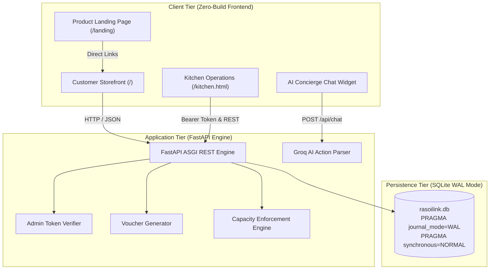

# RasoiLink — Technical Architecture & Operations Manual

**Zero-Commission Direct Mobile Ordering & Real-Time Kitchen Display System (KDS)**  
**Engineered and Maintained by Team TrueAddams** • [GitHub Repository](https://github.com/akshdeepsingh7/RasoiLink)

---

## Table of Contents

1. [Executive Summary & Problem Statement](#1-executive-summary--problem-statement)
2. [Architectural Overview & Design Philosophy](#2-architectural-overview--design-philosophy)
3. [User Interface Layer & Surface Matrix](#3-user-interface-layer--surface-matrix)
   - 3.1 [Customer Storefront (`/`)](#31-customer-storefront-)
   - 3.2 [Operations & Kitchen Display (`/kitchen.html`)](#32-operations--kitchen-display-kitchenhtml)
   - 3.3 [Product Landing Page (`/landing`)](#33-product-landing-page-landing)
   - 3.4 [OpenAPI Interactive Documentation (`/docs`)](#34-openapi-interactive-documentation-docs)
4. [Database Architecture & WAL Concurrency](#4-database-architecture--wal-concurrency)
   - 4.1 [Schema Definitions & Data Dictionary](#41-schema-definitions--data-dictionary)
   - 4.2 [Automatic Seeding Engine](#42-automatic-seeding-engine)
5. [Core Business Logic & Algorithms](#5-core-business-logic--algorithms)
   - 5.1 [Post-Order Retention Engine](#51-post-order-retention-engine)
   - 5.2 [30-Minute Advance Capacity Guard](#52-30-minute-advance-capacity-guard)
   - 5.3 [Groq Llama 3.3 AI Concierge & Strict Action Parser](#53-groq-llama-33-ai-concierge--strict-action-parser)
   - 5.4 [Dual-Mode Fallback Intent Engine](#54-dual-mode-fallback-intent-engine)
   - 5.5 [Web Audio Multi-Tone Alert Synthesizer](#55-web-audio-multi-tone-alert-synthesizer)
   - 5.6 [80mm KOT Thermal Receipt Printing](#56-80mm-kot-thermal-receipt-printing)
   - 5.7 [Margin-Aware Discount Protection Engine](#57-margin-aware-discount-protection-engine)
   - 5.8 [Customer Frequency Loyalty Club](#58-customer-frequency-loyalty-club)
   - 5.9 [Multi-Restaurant Franchise Architecture](#59-multi-restaurant-franchise-architecture)
   - 5.10 [Multi-Channel Order Fulfillment Pipeline](#510-multi-channel-order-fulfillment-pipeline)
   - 5.11 [AI Waste-to-Profit Engine & Dynamic Food Spoilage Prevention](#511-ai-waste-to-profit-engine--dynamic-food-spoilage-prevention)
   - 5.12 [AI Marketing Autopilot & WhatsApp Engagement Engine](#512-ai-marketing-autopilot--whatsapp-engagement-engine)
   - 5.13 [Group Hunger Network & Social Order Pooling](#513-group-hunger-network--social-order-pooling)
   - 5.14 [Offline-First Bharat Mode Architecture](#514-offline-first-bharat-mode-architecture)
   - 5.15 [SafeKitchen Verified Hygiene & Safety Protocol Engine](#515-safekitchen-verified-hygiene--safety-protocol-engine)
6. [Security & Authentication Model](#6-security--authentication-model)
   - 6.1 [Role-Based Access Control](#61-role-based-access-control)
   - 6.2 [Session Token Lifecycle](#62-session-token-lifecycle)
7. [REST API Reference](#7-rest-api-reference)
8. [Operations Manual for Kitchen Staff](#8-operations-manual-for-kitchen-staff)
9. [Automated Verification & Quality Assurance](#9-automated-verification--quality-assurance)
10. [Deployment & Infrastructure Guide](#10-deployment--infrastructure-guide)
11. [Team Attribution & Contributions](#11-team-attribution--contributions)

---

## 1. Executive Summary & Problem Statement

Independent quick-service restaurants, bistros, and cafes in urban India operate on razor-thin operating margins between 12% and 18%. Delivery aggregator monopolies (Swiggy, Zomato) extract between 18% and 30% in platform commissions, payment processing charges, and algorithmic ad placements. Furthermore, third-party aggregators obfuscate customer identities, preventing local restaurateurs from building direct loyalty.

**RasoiLink** eliminates third-party aggregator commissions by providing local food operators with an end-to-end, owned ordering and production operating system:
- **0% Platform Commission**: Every rupee of gross revenue stays with the restaurant.
- **Zero App Installation Friction**: Mobile web Progressive Web App (PWA) launches directly via phone camera QR scan.
- **Sub-Second Ticket Synchronization**: Orders placed by customers appear on the kitchen display in less than 100 milliseconds.
- **Intelligent Customer Retention**: Automated post-order vouchers ensure diners return within 7 days.
- **Cookline Overload Protection**: 30-minute advance slot order capacity caps eliminate rush-hour kitchen bottlenecks.

---

## 2. Architectural Overview & Design Philosophy

RasoiLink is built on three core software engineering principles:



### Design Principles

1. **Zero-Build Architecture**:  
   The frontend uses standard HTML5, modern vanilla ECMAScript (ES6+), and utility-first styling via Tailwind CSS and vector Lucide icons loaded via CDN. No Node.js build pipeline, webpack bundler, or compilation step is required. Changes to templates and scripts are reflected immediately on reload.

2. **High-Concurrency SQLite with WAL Mode**:  
   Rather than introducing the operational overhead of an external relational database for local restaurant setups, RasoiLink uses SQLite running in **Write-Ahead Logging (WAL)** mode. WAL mode enables concurrent reads without locking writes, providing exceptional read performance (<2ms query latency) while safeguarding atomic order updates.

3. **Strict Structured JSON Action Contracts**:  
   The AI concierge does not merely generate conversational prose; it emits strict JSON action arrays (`ADD_ITEM`, `REMOVE_ITEM`, `APPLY_COUPON`, `SET_SCHEDULE`) that directly mutate the frontend state in real time.

---

## 3. User Interface Layer & Surface Matrix

RasoiLink provides four dedicated user interfaces designed for distinct operational workflows:

### 3.1 Customer Storefront (`/`)
- **Dynamic Cafe Branding & Local Location Header**:
  - Live cafe identity banner rendering Store Name, Tagline, Description, Location Pill, Rating badge, and Live Operating Hours from database settings.
  - Quick-switch neighborhood chips (`Connaught Place`, `Barakhamba Road`, `Janpath`, `KG Marg`) for instant delivery address population.
  - "Use Current Location" button utilizing browser HTML5 Geolocation API with high-accuracy GPS coordinates and reverse location tagging.
- **QR Table Detection (`/?table=5`)**: Automatically extracts the table query parameter, locks in Dine-In mode, sets the table badge, and tags kitchen tickets.
- **3 Segregated Ordering Channels with Channel-Specific Scheduling**:
  - `Dine-In`: Dedicated table selection or QR detection with party size selector (1 to 6+ guests). Supports **Immediate Table Service** or **Advance Table Reservation** with date and 30-minute arrival slot.
  - `Takeaway`: Fast counter pickup workflow with packaging and cooking notes. Supports **Immediate Kitchen Prep** (~15-20 mins) or **Advance Takeaway Pickup** with date and 30-minute collection window.
  - `Delivery`: Direct doorstep delivery with full street address, flat/floor number, and landmark capture (+₹30 standard delivery fee). Supports **Immediate Doorstep Delivery** (~35-45 mins) or **Advance Scheduled Delivery** with date and 30-minute drop-off window.
- **Customer Frequency Loyalty & Margin-Safe Discounting**:
  - Promos strip displaying active customer frequency tiers (`WELCOME50`, `REPEAT15`, `REGULAR20`, `HAPPY20`).
  - Automatically identifies customer loyalty status (`First-Time Diner`, `Repeat Patron`, `Regular Diner`, `VIP Patron`) based on mobile order history.
  - Displays dynamic margin protection badge confirming the discount is guaranteed profit-safe.
- **Multi-Day Advance Slot Scheduling**: Lets customers schedule advance orders for Today, Tomorrow, or Day +2 across 30-minute booking slots with real-time capacity guards.
- **Interactive Dish Quick View Modal**: High-res imagery, dietary indicators (Pure Veg / Non-Veg), spice level meter (Mild, Medium, Spicy), calorie estimates, and allergen disclosures.
- **Quick Lifestyle Filters**: One-tap pills for `All Dishes`, `Best Sellers`, `Pure Veg`, `Under ₹100`, `Spicy Kick`, and `Sweet Treats`.
- **Green Dining**: Toggle to skip disposable plastic cutlery and napkins.
- **Staff Appreciation**: Tip selector supporting ₹0, ₹10, ₹20, and ₹50 additions.
- **Simulated Instant Digital Checkout**: UPI app switcher (Google Pay, PhonePe, Paytm, Cred) and card simulator with 256-bit confirmation.
- **Real-Time Receipt & Tracking**: 4-step live order status bar (`PENDING` -> `PREPARING` -> `READY` -> `COMPLETED`) with 1-click cancellation while in `PENDING` state, itemized breakdown, 80mm guest check thermal printing, and WhatsApp sharing.

### 3.2 Operations & Kitchen Display (`/kitchen.html`)
- **Authentication Gate**: Locked with numeric Quick Staff PIN (`1234`) or Manager credentials (`admin` / `rasoi2026`). Features an on-screen tactile keypad for touchscreen POS displays.
- **Tab 1: Live Kitchen Production Board**:
  - **Channel-Segregated 3-Queue Architecture**:
    - **Queue 1: Dine-In Queue** (Live table orders and Advance Table Reservations with Party Size badge & Table #).
    - **Queue 2: Takeaway Queue** (Live counter pickups and scheduled takeaway pickups with customer notes).
    - **Queue 3: Delivery Queue** (Live deliveries and scheduled drop-offs with full street address and landmark).
  - **KDS Timing Filter Pills**: 1-click toggle between `All Timings`, `Immediate Now`, and `Scheduled Advance`.
  - Color-shifting elapsed timers that turn amber at 10 minutes and flashing red at 18 minutes.
  - Approaching prep time alerts for advance orders (`DUE IN 15m`, `OVERDUE by 5m`).
  - 1-tap status updates: `PENDING` -> `PREPARING` -> `READY` -> `COMPLETED`.
  - 1-click **80mm KOT Thermal Printing** with formatted monospace ticket layout.
- **Tab 2: Menu & Dish Economics Management**:
  - Live catalog table showing sale prices, cost prices, profit margins in ₹ and %, dietary badges, calories, and allergens.
  - Inline price editing with instant database propagation.
  - 1-tap out-of-stock switches that immediately update the customer storefront.
  - **Dish Editor Modal**: Allows managers to edit dish Name/Title, Description, Category, Sale Price, Cost Price (with live gross profit margin preview), Spice Level, Calories, and Allergens.
  - "Add New Dish" modal to add new menu creations on the fly with custom cost price.
- **Tab 3: Customer Frequency Promo & Margin Protection Engine**:
  - Displays all active campaign promo codes, customer frequency tier requirements, and dynamic 7-day bounce-back coupons.
  - Create custom campaign vouchers with flat or percentage discounts, customer frequency tier eligibility (`ALL`, `FIRST_TIME`, `REPEAT`, `REGULAR`, `VIP`), minimum order rules, and Dish Margin Protection Cap % (default 50%).
- **Tab 4: Advance Capacity Planner**:
  - Date selector allowing head chefs to inspect and adjust order capacity limits per 30-minute booking slot.
- **Tab 5: Business Analytics**:
  - Real-time Gross Revenue, Total Orders, Average Order Value (AOV), and Retention Coupon Redemption Rate.
  - Channel distribution charts (Dine-In vs Takeaway vs Delivery).
  - Top 5 bestselling menu items table.
- **Tab 6: Store Profile & Settings Management**:
  - Live editor for Store Title, Brand Tagline, About Description, Local Location Name, Full Physical Address, Opening Hours, Contact Phone, and Top Announcement Banner.
  - Updates storefront branding and location info in real-time across all customer devices.
- **Table QR Tent Card Generator**: Pure SVG in-browser generator with printable tent card view.
- **Synthesized Audio Chimes**: Web Audio API chimes for new orders, ready tickets, and completion.

### 3.3 Guest & Cafe Landing Page (`/landing`)
- Welcoming, consumer-friendly presentation designed for diners and cafe guests.
- Highlights authentic Indian comfort food (Masala Chai, Bombay Pav Bhaji, Hyderabadi Biryani, Artisanal Chaat).
- Explains the 3 dining choices: Dine-In Table Ordering, Express Counter Takeaway, and Local Doorstep Delivery.
- Interactive showcase for dish ingredient transparency, 30-minute advance table reservations, and smart dining concierge.
- Explains regular diner loyalty tiers (`WELCOME50`, `REPEAT15`, `REGULAR20`, `VIP25`) and direct fair pricing with zero aggregator markups.
- Guest FAQ covering ordering without an app, spice customizations, and payment options.
- Permanent attribution to Team TrueAddams.

### 3.4 OpenAPI Interactive Documentation (`/docs`)
- Auto-generated Swagger UI documenting every request model, response schema, and parameter.
- Alternate ReDoc documentation available at `/redoc`.

---

## 4. Database Architecture & WAL Concurrency

RasoiLink uses SQLite 3 with Write-Ahead Logging (`WAL` mode) and synchronous normalized writes.

```sql
PRAGMA journal_mode = WAL;
PRAGMA synchronous = NORMAL;
PRAGMA foreign_keys = ON;
```

### 4.1 Schema Definitions & Data Dictionary

#### `categories`
| Column | Type | Constraints | Description |
| :--- | :--- | :--- | :--- |
| `id` | INTEGER | PRIMARY KEY AUTOINCREMENT | Category unique identifier |
| `name` | TEXT | NOT NULL | Category display name (e.g. Chai & Brews) |
| `icon` | TEXT | NOT NULL | Lucide icon identifier (e.g. coffee, utensils) |
| `display_order` | INTEGER | DEFAULT 0 | Display priority on storefront |

#### `menu_items`
| Column | Type | Constraints | Description |
| :--- | :--- | :--- | :--- |
| `id` | INTEGER | PRIMARY KEY AUTOINCREMENT | Item unique identifier |
| `category_id` | INTEGER | REFERENCES categories(id) | Parent category reference |
| `name` | TEXT | NOT NULL | Dish name in English/Hindi |
| `description` | TEXT | NOT NULL | Fresh ingredients and culinary preparation |
| `price` | REAL | NOT NULL | Selling price in Indian Rupees (₹) |
| `cost_price` | REAL | DEFAULT 0.0 | Kitchen food cost in ₹ (used for profit margin protection) |
| `image_url` | TEXT | | High-resolution food photography URL |
| `is_veg` | INTEGER | DEFAULT 1 | 1 = Pure Veg, 0 = Non-Veg |
| `spice_level` | TEXT | DEFAULT 'Medium' | Mild, Medium, or Spicy |
| `is_available` | INTEGER | DEFAULT 1 | 1 = In Stock, 0 = Out of Stock |
| `prep_time_minutes` | INTEGER | DEFAULT 15 | Estimated kitchen preparation duration |
| `calories` | INTEGER | DEFAULT 0 | Estimated calorie count (kcal) |
| `allergens` | TEXT | DEFAULT '' | Allergen disclosure (e.g. Dairy, Gluten) |
| `is_bestseller` | INTEGER | DEFAULT 0 | Flag for best seller highlight chip |

#### `orders`
| Column | Type | Constraints | Description |
| :--- | :--- | :--- | :--- |
| `id` | INTEGER | PRIMARY KEY AUTOINCREMENT | Internal order ID |
| `order_code` | TEXT | UNIQUE NOT NULL | Human-readable tracking token (e.g. RL-7821) |
| `customer_name` | TEXT | NOT NULL | Customer contact name |
| `customer_phone` | TEXT | NOT NULL | Customer 10-digit mobile number |
| `order_type` | TEXT | NOT NULL | DINE_IN, TAKEAWAY, or DELIVERY |
| `table_number` | INTEGER | | Table number (required if DINE_IN) |
| `delivery_address` | TEXT | | Delivery destination address |
| `subtotal` | REAL | NOT NULL | Sum of item totals before discounts |
| `discount_amount` | REAL | DEFAULT 0.0 | Applied voucher discount |
| `tip_amount` | REAL | DEFAULT 0.0 | Voluntary staff tip |
| `total_amount` | REAL | NOT NULL | Final charged amount in ₹ |
| `promo_code` | TEXT | | Applied promotional or retention voucher |
| `payment_method` | TEXT | NOT NULL | UPI, CARD, or CASH |
| `payment_status` | TEXT | DEFAULT 'PAID' | PAID, PENDING, or REFUNDED |
| `order_status` | TEXT | DEFAULT 'PENDING' | PENDING, PREPARING, READY, COMPLETED, CANCELLED |
| `scheduled_date` | TEXT | | Scheduled date (YYYY-MM-DD) |
| `scheduled_slot` | TEXT | | 30-minute booking slot (e.g. 13:00 - 13:30) |
| `no_cutlery` | INTEGER | DEFAULT 0 | 1 = Skip plastic cutlery & napkins |
| `notes` | TEXT | | Custom kitchen instructions |
| `bounce_back_code` | TEXT | | Issued single-use retention voucher |
| `created_at` | TEXT | NOT NULL | ISO-8601 creation timestamp |
| `updated_at` | TEXT | NOT NULL | ISO-8601 status update timestamp |

#### `order_items`
| Column | Type | Constraints | Description |
| :--- | :--- | :--- | :--- |
| `id` | INTEGER | PRIMARY KEY AUTOINCREMENT | Internal line-item ID |
| `order_id` | INTEGER | REFERENCES orders(id) | Associated order ID |
| `item_id` | INTEGER | REFERENCES menu_items(id) | Menu item reference |
| `item_name` | TEXT | NOT NULL | Captured dish name at time of order |
| `quantity` | INTEGER | NOT NULL | Item quantity |
| `unit_price` | REAL | NOT NULL | Captured unit price at time of order |
| `total_price` | REAL | NOT NULL | quantity * unit_price |

#### `promo_codes`
| Column | Type | Constraints | Description |
| :--- | :--- | :--- | :--- |
| `id` | INTEGER | PRIMARY KEY AUTOINCREMENT | Promo voucher ID |
| `code` | TEXT | UNIQUE NOT NULL | Promo code string (uppercase) |
| `title` | TEXT | DEFAULT '' | Campaign title or badge headline |
| `description` | TEXT | DEFAULT '' | Offer subtitle and user eligibility description |
| `discount_type` | TEXT | NOT NULL | PERCENT or FLAT |
| `discount_value` | REAL | NOT NULL | Percentage or flat rupee discount |
| `min_order_value` | REAL | DEFAULT 0.0 | Minimum subtotal required |
| `max_discount` | REAL | | Maximum ceiling for percentage discounts |
| `customer_tier` | TEXT | DEFAULT 'ALL' | Frequency tier: ALL, FIRST_TIME, REPEAT, REGULAR, VIP |
| `min_visits` | INTEGER | DEFAULT 0 | Minimum prior orders required for phone number |
| `max_margin_share_pct`| REAL | DEFAULT 50.0 | Max % of dish gross profit margin granted as discount |
| `is_active` | INTEGER | DEFAULT 1 | 1 = Active, 0 = Disabled |
| `is_single_use` | INTEGER | DEFAULT 0 | 1 = One-time use voucher |
| `used_count` | INTEGER | DEFAULT 0 | Times redeemed |
| `expires_at` | TEXT | | Expiration timestamp |

#### `store_settings`
| Column | Type | Constraints | Description |
| :--- | :--- | :--- | :--- |
| `id` | INTEGER | PRIMARY KEY AUTOINCREMENT | Settings record ID (singleton ID 1) |
| `store_name` | TEXT | NOT NULL | Brand display name (e.g. RasoiLink Artisanal Cafe) |
| `tagline` | TEXT | DEFAULT '' | Brand slogan / mission statement |
| `description` | TEXT | DEFAULT '' | Short cafe introduction and culinary identity |
| `location_name` | TEXT | DEFAULT '' | Neighborhood designation (e.g. Connaught Place, New Delhi) |
| `full_address` | TEXT | DEFAULT '' | Full physical street address |
| `opening_hours` | TEXT | DEFAULT '' | Daily operational hours (e.g. 10:00 AM - 11:00 PM Daily) |
| `phone` | TEXT | DEFAULT '' | Direct store contact telephone |
| `announcement` | TEXT | DEFAULT '' | Top announcement pill text |
| `rating` | REAL | DEFAULT 4.9 | Displayed customer rating score |
| `reviews_count` | INTEGER | DEFAULT 1280 | Number of verified guest reviews |
| `updated_at` | TEXT | NOT NULL | ISO-8601 update timestamp |

#### `time_slots`
| Column | Type | Constraints | Description |
| :--- | :--- | :--- | :--- |
| `id` | INTEGER | PRIMARY KEY AUTOINCREMENT | Slot record ID |
| `slot_date` | TEXT | NOT NULL | Date string (YYYY-MM-DD) |
| `slot_time` | TEXT | NOT NULL | Time window (e.g. 12:30 - 13:00) |
| `max_capacity` | INTEGER | DEFAULT 8 | Maximum allowed orders per slot |
| `booked_count` | INTEGER | DEFAULT 0 | Confirmed booked orders |

#### `admin_users`
| Column | Type | Constraints | Description |
| :--- | :--- | :--- | :--- |
| `id` | INTEGER | PRIMARY KEY AUTOINCREMENT | Admin user ID |
| `username` | TEXT | UNIQUE NOT NULL | Manager login identifier |
| `password_hash` | TEXT | NOT NULL | SHA-256 hashed password with salt |
| `pin` | TEXT | | 4-digit quick staff PIN (`1234`) |
| `role` | TEXT | NOT NULL | MANAGER or STAFF |
| `full_name` | TEXT | NOT NULL | Display name |

#### `admin_sessions`
| Column | Type | Constraints | Description |
| :--- | :--- | :--- | :--- |
| `id` | INTEGER | PRIMARY KEY AUTOINCREMENT | Session record ID |
| `token` | TEXT | UNIQUE NOT NULL | Bearer session token (`RS-SESSION-XXXX`) |
| `user_id` | INTEGER | REFERENCES admin_users(id) | Associated user ID |
| `created_at` | TEXT | NOT NULL | Session issue timestamp |
| `expires_at` | TEXT | NOT NULL | Session expiry timestamp (24 hours) |

#### `restaurants`
| Column | Type | Constraints | Description |
| :--- | :--- | :--- | :--- |
| `id` | TEXT | PRIMARY KEY | Outlet identifier (e.g. `cp-artisan`, `cyberhub-bistro`) |
| `name` | TEXT | NOT NULL | Restaurant brand name |
| `slug` | TEXT | UNIQUE NOT NULL | URL-safe slug |
| `tagline` | TEXT | | Culinary positioning tagline |
| `description` | TEXT | | Menu & concept overview |
| `cuisine_type` | TEXT | | Signature offerings |
| `location_name` | TEXT | NOT NULL | Neighborhood designation |
| `full_address` | TEXT | NOT NULL | Physical street address |
| `city` | TEXT | NOT NULL | City designation |
| `phone` | TEXT | NOT NULL | Direct contact phone |
| `opening_hours` | TEXT | NOT NULL | Operating hours |
| `rating` | REAL | DEFAULT 4.9 | Customer review score |
| `reviews_count`| INTEGER | DEFAULT 1200 | Verified reviews counter |
| `delivery_time_mins` | TEXT | DEFAULT '25-35 mins' | Average prep & delivery window |
| `price_for_two` | TEXT | DEFAULT '₹350 for two' | Dine-in price indicator |
| `image_url` | TEXT | | Banner hero image URL |
| `is_active` | INTEGER | DEFAULT 1 | 1 = Active outlet |
| `table_count` | INTEGER | DEFAULT 20 | Number of dine-in tables |
| `created_at` | TEXT | NOT NULL | ISO-8601 creation timestamp |

#### `waste_flash_deals`
| Column | Type | Constraints | Description |
| :--- | :--- | :--- | :--- |
| `id` | INTEGER | PRIMARY KEY AUTOINCREMENT | Flash deal ID |
| `item_id` | INTEGER | REFERENCES menu_items(id) | Target surplus dish |
| `discount_pct` | REAL | NOT NULL | Applied discount percentage (25%–50%) |
| `original_price`| REAL | NOT NULL | Menu catalog price |
| `discount_price`| REAL | NOT NULL | Discounted flash sale price |
| `quantity_available` | INTEGER | DEFAULT 5 | Units capped to prevent overselling |
| `quantity_sold`| INTEGER | DEFAULT 0 | Units purchased under deal |
| `reason` | TEXT | | Spoilage prevention rationale |
| `expires_at` | TEXT | NOT NULL | ISO-8601 expiry timestamp |
| `is_active` | INTEGER | DEFAULT 1 | 1 = Deal live on storefront |
| `restaurant_id` | TEXT | DEFAULT 'cp-artisan' | Outlet scoping |
| `created_at` | TEXT | NOT NULL | Creation timestamp |

#### `waste_logs`
| Column | Type | Constraints | Description |
| :--- | :--- | :--- | :--- |
| `id` | INTEGER | PRIMARY KEY AUTOINCREMENT | Audit log ID |
| `item_id` | INTEGER | NOT NULL | Rescued dish ID |
| `quantity_saved` | INTEGER | DEFAULT 1 | Portions rescued from waste |
| `rupees_saved` | REAL | DEFAULT 0 | Revenue recovered |
| `co2_kg_avoided` | REAL | DEFAULT 0 | Greenhouse gas emissions avoided ($2.5 \text{ kg } CO_2\text{e} / \text{kg}$) |
| `logged_at` | TEXT | NOT NULL | Audit timestamp |
| `restaurant_id` | TEXT | DEFAULT 'cp-artisan' | Outlet scoping |

#### `marketing_campaigns`
| Column | Type | Constraints | Description |
| :--- | :--- | :--- | :--- |
| `id` | INTEGER | PRIMARY KEY AUTOINCREMENT | Campaign ID |
| `campaign_name` | TEXT | NOT NULL | Marketing campaign title |
| `target_segment`| TEXT | NOT NULL | RFM segment (`CHURN_RISK`, `VIP`, `CHAI_SQUAD`) |
| `template_text` | TEXT | NOT NULL | AI generated WhatsApp copy |
| `promo_code` | TEXT | | Embedded incentive code |
| `channel` | TEXT | DEFAULT 'WHATSAPP' | Dispatch channel |
| `total_recipients`| INTEGER | DEFAULT 0 | Segment audience size |
| `sent_count` | INTEGER | DEFAULT 0 | Messages dispatched |
| `clicks_count` | INTEGER | DEFAULT 0 | WhatsApp clicks recorded |
| `conversions_count` | INTEGER | DEFAULT 0 | Orders generated from campaign |
| `revenue_generated` | REAL | DEFAULT 0 | Attributed sales |
| `created_at` | TEXT | NOT NULL | Creation timestamp |

#### `group_pools`
| Column | Type | Constraints | Description |
| :--- | :--- | :--- | :--- |
| `id` | INTEGER | PRIMARY KEY AUTOINCREMENT | Pool ID |
| `pool_code` | TEXT | UNIQUE NOT NULL | 6-character pool code (e.g. `HOSTEL`) |
| `title` | TEXT | NOT NULL | Room title (e.g. Hostel 7 Night Munchies) |
| `pool_type` | TEXT | DEFAULT 'STUDENT_HOSTEL'| Group category |
| `location_name` | TEXT | NOT NULL | Campus / Office / Society name |
| `delivery_address`| TEXT | NOT NULL | Consolidated delivery point |
| `creator_name` | TEXT | NOT NULL | Pool host name |
| `creator_phone` | TEXT | NOT NULL | Pool host contact |
| `restaurant_id` | TEXT | DEFAULT 'cp-artisan' | Outlet scoping |
| `target_amount` | REAL | DEFAULT 1500.0 | Pool milestone threshold |
| `current_amount`| REAL | DEFAULT 0.0 | Live pooled subtotal |
| `discount_tier_pct` | REAL | DEFAULT 0.0 | Current unlocked discount (10%–25%) |
| `status` | TEXT | DEFAULT 'ACTIVE' | `ACTIVE`, `FINALIZED`, `EXPIRED` |
| `order_code` | TEXT | | Consolidated master kitchen ticket |
| `expires_at` | TEXT | NOT NULL | Pool countdown deadline |
| `created_at` | TEXT | NOT NULL | Creation timestamp |

#### `group_pool_members`
| Column | Type | Constraints | Description |
| :--- | :--- | :--- | :--- |
| `id` | INTEGER | PRIMARY KEY AUTOINCREMENT | Member entry ID |
| `pool_code` | TEXT | REFERENCES group_pools(pool_code) | Target pool |
| `participant_name` | TEXT | NOT NULL | Diner name |
| `participant_phone`| TEXT | NOT NULL | Diner mobile |
| `items_json` | TEXT | NOT NULL | JSON array of ordered dishes |
| `subtotal` | REAL | NOT NULL | Member cart subtotal |
| `discount_amount` | REAL | DEFAULT 0.0 | Savings under group tier |
| `final_amount` | REAL | NOT NULL | Payable amount |
| `payment_status` | TEXT | DEFAULT 'PAID' | Settlement status |
| `notes` | TEXT | | Special prep instructions |
| `created_at` | TEXT | NOT NULL | Order join timestamp |

#### `safekitchen_audits`
| Column | Type | Constraints | Description |
| :--- | :--- | :--- | :--- |
| `id` | INTEGER | PRIMARY KEY AUTOINCREMENT | Audit record ID |
| `restaurant_id` | TEXT | UNIQUE REFERENCES restaurants(id) | Outlet scoping |
| `trust_score` | INTEGER | NOT NULL | Audited Trust Score (0–100) |
| `fssai_license` | TEXT | NOT NULL | Verified FSSAI License Number |
| `audit_date` | TEXT | NOT NULL | Latest inspection date |
| `auditor_name` | TEXT | NOT NULL | FSSAI empanelled auditor / agency |
| `checks_json` | TEXT | NOT NULL | JSON array of 9 verified hygiene protocols |
| `is_verified` | INTEGER | DEFAULT 1 | 1 = Fully verified SafeKitchen outlet |
| `created_at` | TEXT | NOT NULL | Creation timestamp |
| `updated_at` | TEXT | NOT NULL | Last update timestamp |

### 4.2 Automatic Seeding Engine
On initial startup, `database.init_db()` automatically seeds:
- 5 categories with vector icon identifiers.
- 22 popular Indian dishes with authentic pricing (₹30 to ₹260), accurate calorie estimates, and allergen tags.
- Seed promotional codes: `HAPPY20` (20% off up to ₹100), `WELCOME50` (Flat ₹50 off min ₹200), and `RASOI10` (10% off).
- 25 daily 30-minute time slots (10:00 to 22:30) for Today, Tomorrow, and Day +2 with default capacity of 8 orders.
- Default Admin Credentials:
  - Staff PIN: `1234`
  - Manager: `admin` / `rasoi2026`

---

## 5. Core Business Logic & Algorithms

### 5.1 Post-Order Retention Engine
To solve the critical challenge of customer re-engagement without relying on spam emails, RasoiLink implements an automated bounce-back voucher generator on every completed checkout:
1. When an order is placed, a cryptographically random 4-character suffix is combined with the prefix `BACK50-` (e.g. `BACK50-W8N2`).
2. An entry is created in `promo_codes` with:
   - `discount_type = 'FLAT'`
   - `discount_value = 50.0`
   - `min_order_value = 150.0`
   - `is_single_use = 1`
   - `expires_at = now + 7 days`
3. The voucher code and a banner message are embedded directly into the live digital receipt.
4. When redeemed on a subsequent order, the code's `used_count` increments to 1 and it is locked from further use.

### 5.2 30-Minute Advance Capacity Guard
To prevent kitchen bottlenecks during lunch and dinner rushes:
1. Every advance order checks `time_slots` for `(slot_date, slot_time)`.
2. If `booked_count >= max_capacity`, the order is rejected with `HTTP 400: Selected time slot is fully booked`.
3. If capacity is available, `booked_count` is incremented atomically.
4. If an order in `PENDING` state is cancelled via `POST /api/orders/{code}/cancel`, `booked_count` is decremented atomically, restoring capacity.

### 5.3 Groq Llama 3.3 AI Concierge & Strict Action Parser
The floating AI ordering assistant (`/api/chat`) uses Groq's high-speed inference engine running `llama-3.3-70b-versatile`:
- **Context Injection**: Every prompt is dynamically injected with the active catalog, out-of-stock items, active promo codes, and the user's current cart tray.
- **Strict JSON Action Contract**: The model returns a conversational reply alongside a structured JSON action array:
  ```json
  {
    "message": "Added 2 Cutting Chais and 1 Pav Bhaji to your tray. Applied coupon HAPPY20 for 20% off!",
    "actions": [
      {"action": "ADD_ITEM", "item_id": 1, "item_name": "Masala Cutting Chai", "quantity": 2},
      {"action": "ADD_ITEM", "item_id": 6, "item_name": "Bombay Pav Bhaji", "quantity": 1},
      {"action": "APPLY_COUPON", "code": "HAPPY20"}
    ]
  }
  ```
- The frontend parses these actions and directly mutates the cart tray state, recalculates totals, and validates discounts.

### 5.4 Dual-Mode Fallback Intent Engine
If `GROQ_API_KEY` is absent or the external API is unreachable, the system automatically falls back to an internal regex and keyword intent engine. The fallback engine:
- Scans user messages for quantity indicators and dish aliases (e.g. "chai", "pav bhaji", "biryani").
- Detects promo codes like "happy20" and emits `APPLY_COUPON`.
- Answers dietary questions (e.g. "vegetarian", "spicy").
- Guarantees 100% operational uptime under any network condition.

### 5.5 Web Audio Multi-Tone Alert Synthesizer & Volume Slider
The Kitchen Display board synthesizes customizable audio alert tones using the browser's native `AudioContext` without requiring external sound files:
- **Volume Control**: Native slider adjusting gain from 10% to 100% saved in `localStorage`.
- **Alert Tone Profiles**:
  - `Modern Chime`: Dual-tone sine wave at 784 Hz (G5) and 880 Hz (A5).
  - `Counter Bell`: Crisp high-frequency triangle wave at 1046.5 Hz (C6).
  - `Kitchen Buzzer`: Fast industrial sawtooth double-pulse at 320 Hz for loud commercial cooklines.
  - `Soft Marimba`: Three-tone melodic arpeggio (523 Hz -> 659 Hz -> 784 Hz).

### 5.6 80mm KOT & Customer Thermal Receipt Printing
The platform provides two dedicated print pipelines:
- **Kitchen Order Tickets (KOT)**: Printed from KDS with table number, time elapsed, and preparation notes.
- **Customer Guest Checks**: Accessible from the customer modal with itemized dish pricing, settled amount, and clean thermal CSS rules suppressing UI buttons and navbars during `window.print()`.

### 5.7 Storefront 1-Click Re-Ordering & Order History
- Customer orders are persisted locally (`rasoilink_order_history`).
- The "My Orders" modal displays recent visits with itemized breakdowns and real-time status.
- Clicking **Re-Order Meal** instantly refills the tray with the exact quantities and notes, allowing fast re-ordering.

### 5.8 Direct WhatsApp Bill & Tracking Share
- Customers can share their live order confirmation directly via WhatsApp (`api.whatsapp.com`).
- Generates a pre-formatted receipt text with order code, dishes, total paid, and direct tracking URL.

### 5.9 Deep Multi-Field Search & Channel Filtering in KDS
- Staff can search active queues by Table number, Order Code, Customer Name, Phone number, or individual dish names.
- Queue filtering buttons allow toggling between All Channels, Dine-In, Takeaway, and Delivery, plus viewing Completed tickets.

### 5.10 Customer Frequency Loyalty Tiers & Margin Protection Guard
To prevent revenue erosion while aggressively driving customer retention, RasoiLink employs a two-tier economic safeguard:
1. **Customer Order Frequency Tracking**:
   - The system tracks historical non-cancelled orders by `customer_phone`.
   - Diners are categorized dynamically into four progressive loyalty tiers:
     - `FIRST_TIME` (0 prior orders): Eligible for first-order welcome offers (e.g. `WELCOME50`).
     - `REPEAT` (1-2 prior orders): Unlocks repeat patron incentives (e.g. `REPEAT15`).
     - `REGULAR` (3-4 prior orders): Unlocks regular diner loyalty discounts (e.g. `REGULAR20`).
     - `VIP` (5+ prior orders): Unlocks premium VIP appreciation discounts (e.g. `VIP25`).
     - `ALL`: Open to all patrons (e.g. `HAPPY20`, `RASOI10`).
   - If an ineligible diner attempts to apply a higher-tier code, validation fails with an informative prompt showing how many orders are needed to unlock that perk.
2. **Dish Gross Profit Margin Protection**:
   - Every dish in `menu_items` stores an ingredient cost price (`cost_price`).
   - At cart validation and checkout, the aggregate gross profit margin is computed:
     $$\text{Gross Margin} = \text{Cart Subtotal} - \sum (\text{item.quantity} \times \text{item.cost\_price})$$
   - Every promotional coupon specifies a `max_margin_share_pct` (defaulting to 50%).
   - The maximum allowable discount is strictly capped:
     $$\text{Max Allowable Discount} = \text{Gross Margin} \times \left(\frac{\text{max\_margin\_share\_pct}}{100}\right)$$
     $$\text{Final Discount} = \min(\text{Nominal Discount}, \text{Max Allowable Discount})$$
   - **Economic Guarantee**: The restaurant is mathematically guaranteed to retain at least $(100 - \text{max\_margin\_share\_pct})\%$ of gross profit on every order, strictly preventing negative-margin or loss-making promotional sales.

### 5.11 AI Waste-to-Profit Engine & Dynamic Food Spoilage Prevention
Urban Indian restaurants face significant daily financial losses due to perishable ingredient prep mismatches and end-of-shift food disposal. The AI Waste-to-Profit Engine continuously balances inventory velocity:
1. **Demand Forecasting Algorithm**:
   - Computes daily sales expectations using day-of-week demand multipliers ($M_{\text{weekday}} = 1.0$, $M_{\text{Fri}} = 1.15$, $M_{\text{Sat/Sun}} = 1.30$).
   - Computes real-time shift progress:
     $$\text{Shift Progress} = \min\left(1.0, \max\left(0.1, \frac{\text{Current Hour} - \text{Store Open Hour}}{\text{Total Operational Hours}}\right)\right)$$
   - Evaluates remaining expected sales for the shift and flags estimated leftovers:
     $$\text{Estimated Leftover} = \max(0, \text{Current Stock} - \text{Remaining Expected Sales})$$
2. **Spoilage Risk Stratification**:
   - **High Risk**: Perishable category (fresh chai dairy, kathi roll paneer, pav bhaji batches) with estimated leftover $\ge 3$ or shift progress $> 65\%$.
   - **Medium Risk**: Estimated leftover $\ge 2$.
   - **Optimal**: Stock levels balanced with forecasted demand.
3. **Dynamic Flash Deals**:
   - Recommends dynamic flash discounts (25% to 50%) applied with an expiration window (2–4 hours) and allocated surplus portion caps.
   - Live customer storefront carousel presents these deals with animated countdown timers and single-click "Rescue & Add to Tray" buttons.
4. **Environmental Footprint Quantification**:
   - Every meal portion rescued prevents approx. 0.38 kg of organic waste from entering landfills and avoids approx. $0.35 \times 2.5 = 0.875 \text{ kg CO}_2\text{e}$ emissions.

### 5.12 AI Marketing Autopilot & WhatsApp Customer Retention
Traditional aggregator ads charge exorbitant CPC rates while customer contact numbers remain masked. The AI Marketing Autopilot restores direct diner relationships:
1. **RFM Segmentation Architecture**:
   - Scans non-cancelled orders grouped by `customer_phone`.
   - Evaluates:
     - **Recency**: Days elapsed since most recent order ($D_{\text{last}}$).
     - **Frequency**: Total lifetime completed visits ($N_{\text{orders}}$).
     - **Monetary**: Total lifetime spend and Average Order Value (AOV).
   - Automated Segment Categorization:
     - `CHURN_RISK`: $N_{\text{orders}} \ge 2$ and $D_{\text{last}} \ge 7$ days (at risk of drifting to competitors).
     - `VIP_LOYALISTS`: $N_{\text{orders}} \ge 4$ or Total Spend $\ge ₹1,200$.
     - `BIRYANI_LOVERS`: Favorite dish matches slow-cooked rice/dum biryani bowls.
     - `CHAI_SQUAD`: Regular daily chai & tapri brew consumers.
     - `WEEKEND_REGULARS`: Diners with predominant Friday–Sunday ordering frequency.
     - `FIRST_TIMER_WINBACK`: Exactly 1 recorded order within the past 7 days.
2. **Hyper-Personalized Copy Generator**:
   - Dynamic tone injection (`TAPRI_HINGLISH`, `FRIENDLY`, `URGENT_FOMO`, `FESTIVE`).
   - Automatically injects customer's name, their favorite dish, and generates an exclusive voucher code into `promo_codes`.
3. **Zero-Cost WhatsApp Direct Protocol**:
   - Generates pre-formatted Click-to-Chat deep links (`https://wa.me/{phone}?text={encoded_message}`) for instant dispatch without per-message aggregator fees.

### 5.13 Group Hunger Network & Social Order Pooling
Designed specifically for college hostels, student PG clusters, and corporate tech park floors:
1. **Shared Food Pool Lifecycle**:
   - A host creates a pool (e.g. `HOSTEL`, `CYBER1`) with delivery drop-off location and an automated closing timer (30 to 90 minutes).
   - Co-diners join via unique 6-character code or shareable deep link (`/?pool=HOSTEL`).
2. **Progressive Discount Ladder**:
   - **Tier 0** (Subtotal $< ₹400$): Standard prices.
   - **Tier 1** (Subtotal $\ge ₹400$ or $\ge 2$ diners): **10% OFF** + Free Delivery.
   - **Tier 2** (Subtotal $\ge ₹800$ or $\ge 4$ diners): **15% OFF** + Free Cutting Chai round.
   - **Tier 3** (Subtotal $\ge ₹1,500$ or $\ge 6$ diners): **25% Mega Group Saver**.
3. **Consolidated Cookline Batching**:
   - Upon pool finalization, member orders are aggregated into a unified kitchen ticket with consolidated dish item counts (e.g. 6x Pav Bhaji, 8x Cutting Chai) alongside individual member packaging labels.

### 5.14 Offline-First Bharat Mode & Regional Voice Accessibility
1. **Progressive Web App Service Worker (`sw.js`)**:
   - Implements Stale-While-Revalidate caching for static assets, styles, and scripts.
   - Network-First with Cache-Fallback for `/api/menu` and `/api/store/settings`, enabling 100% offline menu browsing.
2. **Local Queue & Idempotent WAL Sync Engine**:
   - When offline, orders generate temporary `OFFLINE-XXXX` references and queue in client `localStorage`.
   - On network reconnection (`online` event or 20s heartbeat), the client automatically sends queued orders to `/api/orders/sync-batch`.
   - The backend enforces strict idempotency: if an order with that `offline_ref` was already saved, it immediately returns the existing record without duplicate billing.
3. **8-Language Bharat i18n Architecture**:
   - Full dictionary translation across English, हिन्दी (Hindi), हिंग्लिश (Hinglish Tapri), ગુજરાતી (Gujarati), मराठी (Marathi), தமிழ் (Tamil), বাংলা (Bengali), and తెలుగు (Telugu).
   - Dynamic DOM text translation via custom `data-i18n` attributes and reactive `languageChanged` event.
4. **Multilingual Voice Assistant**:
   - Web Speech API integration (`SpeechRecognition`) mapped to regional language locales (`hi-IN`, `gu-IN`, `ta-IN`, etc.).
   - Voice-to-cart parsing matches dish names and numerical quantities (e.g. "Do cutting chai add karo"), adds them to the tray, and responds with natural voice audio feedback via `SpeechSynthesis`.

### 5.15 SafeKitchen Verified Hygiene & Safety Protocol Engine
Provides diners with transparent, audited food safety verification directly on the restaurant profile card:
1. **Audited FSSAI Safety Protocol Checklist**:
   - Displays nine mandated kitchen hygiene protocols in exact sequential order:
     1. Handwashing completed
     2. Gloves and apron changed
     3. Veg/Non-veg separated
     4. Fresh ingredients logged
     5. Oil-change log updated
     6. Fridge temperature checked
     7. Cleaning schedule completed
     8. Allergy-safe handling available
     9. Packaging hygiene verified
2. **Sequential Motion Choreography**:
   - Each check item renders with a smooth fade-in, slight slide-up, and animated `#22C55E` SVG checkmark stroke, staggered at ~300ms intervals.
   - Upon completion of all checks, a dynamic **SafeKitchen Verified · Trust Score XX/100** badge activates with a subtle one-time pulse/glow animation.
3. **Smart Replay Prevention & Reduced Motion**:
   - Stores session state (`safekitchen_seen_${restaurantId}`) to prevent disruptive animation replays during repeated browsing.
   - Honors `@media (prefers-reduced-motion: reduce)` accessibility standards by rendering statically and instantaneously.
4. **Multi-Outlet Real Safety Audits**:
   - Backed by the `safekitchen_audits` database table with real-world FSSAI inspection records and outlet-specific Trust Scores (CP: 98, Cyber Hub: 97, Khan Market: 99, Indiranagar: 96), with graceful 404 error handling for unverified outlets.

---

## 6. Security & Authentication Model

### 6.1 Role-Based Access Control
The Operations and Kitchen Display (`/kitchen.html`) enforces two authentication tiers:
1. **Quick Staff PIN (`role = 'STAFF'`)**:
   - 4-digit numeric PIN (`1234`).
   - Intended for line cooks, baristas, and dispatch staff on touchscreen POS terminals.
   - Grants ticket status progression, 80mm KOT printing, and 1-tap stock toggles.
2. **Manager Credentials (`role = 'MANAGER'`)**:
   - Username (`admin`) and salted SHA-256 hashed password (`rasoi2026`).
   - Intended for restaurant owners and head chefs.
   - Grants all staff permissions plus Business Analytics, Promo Voucher creation, Catalog price editing, and Capacity limits adjustment.

### 6.2 Session Token Lifecycle
Upon successful authentication via `POST /api/admin/login`:
1. The server generates a cryptographic session token: `RS-SESSION-` followed by 32 hex characters.
2. A record is created in `admin_sessions` with a 24-hour expiration timestamp.
3. Protected endpoints verify the token via the `Authorization: Bearer <token>` or `X-Admin-Token: <token>` header.
4. Calling `POST /api/admin/logout` invalidates the session in the database immediately.

---

## 7. REST API Reference

| Method | Endpoint | Auth | Description |
| :--- | :--- | :--- | :--- |
| `GET` | `/api/health` | None | Service health check and Groq API status |
| `POST` | `/api/admin/login` | None | Authenticate via PIN (`1234`) or credentials (`admin`/`rasoi2026`) |
| `GET` | `/api/admin/verify` | Bearer | Verify active session token |
| `POST` | `/api/admin/logout` | Bearer | Terminate active admin session |
| `GET` | `/api/admin/analytics` | Bearer | Retrieve gross revenue, total orders, AOV, and channel breakdown |
| `GET` | `/api/admin/promos` | Bearer | List active marketing promo codes and retention bounce-back vouchers |
| `POST` | `/api/admin/promos` | Bearer | Create a new custom promotional campaign voucher |
| `POST` | `/api/admin/menu/item` | Bearer | Add a new dish to the live catalog |
| `GET` | `/api/store/settings` | None | Retrieve store profile, branding, address, hours, and announcements |
| `POST` | `/api/admin/store/settings` | Bearer | Update store branding, location, opening hours, and contact details |
| `PUT` | `/api/admin/menu/{id}` | Bearer | Full dish editor (title, description, price, cost price, spice, allergens) |
| `PATCH`| `/api/admin/menu/{id}` | Bearer | Update dish price, bestseller highlight, or availability |
| `GET` | `/api/menu` | None | Retrieve menu categories and all dishes with nutritional metadata |
| `POST` | `/api/menu/{id}/toggle-stock` | None/Staff | Toggle dish stock availability on/off |
| `GET` | `/api/slots?date=YYYY-MM-DD` | None | Retrieve 30-min slots with capacity and booked counts |
| `POST` | `/api/slots/capacity` | Bearer | Update maximum order capacity for a specific time slot |
| `POST` | `/api/coupons/validate` | None | Validate promo code against order subtotal |
| `POST` | `/api/orders` | None | Create order, enforce slot caps, and issue bounce-back coupon |
| `GET` | `/api/orders` | None/Staff | List active orders (filterable by status) |
| `GET` | `/api/orders/{code}` | None | Retrieve single order status for customer tracking receipt |
| `POST` | `/api/orders/{code}/status` | None/Staff | Advance ticket status (PENDING -> PREPARING -> READY -> COMPLETED) |
| `POST` | `/api/orders/{code}/cancel` | None | Cancel an order and release booked slot capacity |
| `GET` | `/api/kitchen/stats` | None/Staff | Real-time kitchen production metrics and daily revenue |
| `POST` | `/api/chat` | None | AI chatbot concierge with structured JSON action parser |
| `GET` | `/api/admin/export/orders.csv` | Bearer/Staff | Export all or date-filtered orders as accounting CSV attachment |
| `GET` | `/api/admin/export/daily-closing.csv` | Bearer/Staff | Export daily aggregated sales, discounts, tips, and channel reports |
| `GET` | `/api/restaurants` | None | List all active multi-location restaurant outlets |
| `GET` | `/api/restaurants/{restaurant_id}` | None | Retrieve single restaurant branch details and opening hours |
| `POST` | `/api/admin/restaurants` | Bearer | Register a new franchise branch into the network |
| `GET` | `/api/waste-to-profit/predictions` | None | Predict daily food demand, shift leftovers, and surplus spoilage risk |
| `POST` | `/api/waste-to-profit/apply-discount` | None | Activate an Eco-Saver flash discount (25%–50%) on surplus batches |
| `GET` | `/api/waste-to-profit/active-deals` | None | Fetch live flash deals for storefront discount carousel |
| `GET` | `/api/waste-to-profit/impact` | None | Real-time sustainability metrics (meals rescued, ₹ saved, CO₂ prevented) |
| `GET` | `/api/marketing/segments` | None | RFM behavioral clustering (Churn risk, VIP, Biryani lovers, Chai squad) |
| `POST` | `/api/marketing/campaigns` | None | Deploy an AI WhatsApp marketing campaign with custom copy |
| `GET` | `/api/marketing/campaigns` | None | Retrieve past marketing campaign ROI and conversion analytics |
| `POST` | `/api/marketing/preview-offer` | None | Generate personalized WhatsApp click-to-chat copy in 4 tones |
| `POST` | `/api/group-pools` | None | Create a new community food pool for hostel, office, or society |
| `GET` | `/api/group-pools` | None | Discover active community pools by restaurant outlet |
| `GET` | `/api/group-pools/{code}` | None | Live pool room state, participants, tier discount progress, countdown |
| `POST` | `/api/group-pools/{code}/join` | None | Join community pool with individual cart items and unlocked discount |
| `POST` | `/api/group-pools/{code}/finalize` | None | Consolidate pooled items into a unified kitchen master ticket |
| `POST` | `/api/orders/sync-offline` | None | Synchronize single locally queued offline order (Idempotent) |
| `POST` | `/api/orders/sync-batch` | None | Synchronize batch of offline orders placed without internet |
| `GET` | `/api/orders/offline-status` | None | Node connectivity and offline synchronization statistics |
| `GET` | `/api/safekitchen/{restaurant_id}` | None | Retrieve audited kitchen hygiene protocols & Trust Score |
| `GET` | `/api/safekitchen` | None | Default outlet SafeKitchen audit status and checklist |

---

## 8. Operations Manual for Kitchen Staff

### Daily Kitchen Workflow
1. **Morning Opening**:
   - Open browser on kitchen tablet or screen: `http://localhost:8000/kitchen.html`.
   - Tap Quick Staff PIN `1234` on the on-screen numeric keypad.
   - Verify Audio Chime is enabled by clicking **Test Sound**.
2. **Managing Live Orders**:
   - When a ticket arrives, an audio chime plays and the ticket appears in the **Dine-In** or **Takeaway** column.
   - Tap **Start Cooking** to move ticket from `PENDING` to `PREPARING`. The customer's mobile receipt updates immediately.
   - Tap **Print KOT** if physical thermal slips are used on the line.
   - When food is plated, tap **Mark Ready**. The customer receipt alerts the diner.
   - When food is delivered or picked up, tap **Complete**.
3. **Handling Sold-Out Ingredients**:
   - Switch to the **Menu & Inventory** tab.
   - Locate the dish and toggle the **Stock Switch** off.
   - The dish is greyed out with an "Out of Stock" tag on the customer storefront.
4. **Advance Scheduled Orders**:
   - Review the **Scheduled Orders** column for tickets with approaching due times.
   - Tickets due within 15 minutes display an amber alert badge (`DUE IN 12m`).
   - Overdue tickets flash with a red alert badge.

---

## 9. Automated Verification & Quality Assurance

RasoiLink includes an end-to-end automated verification test suite:

```bash
python verify_system.py
```

### Verification Coverage (27/27 Tests Passing)
1. **Health Check**: Confirms service uptime and Groq configuration status.
2. **Menu & Seeding**: Validates 5 categories and 22 seeded Indian cafe items.
3. **Quick Staff PIN Auth**: Verifies 4-digit PIN authentication (`1234`).
4. **Manager Credentials Auth**: Verifies username/password auth (`admin` / `rasoi2026`).
5. **Session Token Verification**: Validates 24-hour cryptographic bearer token.
6. **Business Analytics**: Checks gross revenue, AOV, and channel distribution math.
7. **Custom Promo Creation**: Tests runtime promo code generation (`CHAI50`).
8. **1-Tap Out-of-Stock Toggle**: Tests immediate stock toggling on item catalog.
9. **Time Slot Capacity Retrieval**: Validates 25 slots retrieved per date.
10. **Slot Capacity Adjustment**: Tests runtime capacity limit updates.
11. **Coupon Validation Engine**: Validates discount computation for `HAPPY20`.
12. **Dine-In Order Flow**: Tests order creation with Table #5, tip, and cutlery toggle.
13. **Retention Voucher Generation**: Validates single-use `BACK50-XXXX` voucher issuance.
14. **Bounce-Back Coupon Redemption**: Validates voucher validation on subsequent checkout.
15. **Ticket Status Lifecycle**: Advances order through `PREPARING` -> `READY` -> `COMPLETED`.
16. **Kitchen Operations Metrics**: Validates real-time ticket counts and average prep velocity.
17. **Order Cancellation Flow**: Releases capacity upon cancellation while pending.
18. **Chatbot Action Engine**: Tests structured JSON action emission and rule-based fallback.
19. **Admin Session Logout**: Destroys active session token.
20. **Financial CSV Export**: Verifies itemized accounting and daily closing pipelines.
21. **Channel Permutations**: Verifies all 6 Dine-In, Takeaway, and Delivery order modes.
22. **Frequency Loyalty & Margin Guard**: Enforces visit thresholds and prevents below-margin discounts.
23. **Store Branding & Dish Editor**: Verifies live cafe profile updates and catalog editing.
24. **Multi-Restaurant Isolation**: Validates multi-outlet ticket isolation and outlet routing.
25. **AI Waste-to-Profit Engine**: Tests 22-item demand forecasting, surplus risk detection, and dynamic flash deals.
26. **AI Marketing Autopilot**: Tests RFM customer segmentation, 4-tone WhatsApp copy generation, and campaign tracking.
27. **Group Hunger Network**: Tests 6-char pool rooms, 10%–25% tier unlocks, and master kitchen order consolidation.
28. **Offline-First Bharat Mode**: Tests zero-internet local queueing, idempotency, and background auto-sync.
29. **SafeKitchen Verified Engine**: Tests 9/9 hygiene protocols in order, Trust Score 98/100, FSSAI verification & multi-outlet audits.

---

## 10. Deployment & Infrastructure Guide

### Local Development
```bash
# Clone the repository
git clone https://github.com/akshdeepsingh7/RasoiLink.git
cd RasoiLink

# Create virtual environment
python -m venv .venv
source .venv/bin/activate  # On Windows: .venv\Scripts\activate

# Install dependencies
pip install -r requirements.txt

# Run the development server
python -m uvicorn main:app --host 0.0.0.0 --port 8000 --reload
```

### Production Multi-Worker Deployment (Gunicorn + Uvicorn ASGI Workers)
In production environments (Docker, Linux VPS, Kubernetes, Render, Railway), RasoiLink pairs **Gunicorn** as the master process supervisor with high-throughput **Uvicorn** ASGI worker processes:

```bash
# Start Gunicorn using the production configuration
gunicorn -c gunicorn_conf.py main:app

# Or start with explicit CLI flags (4 concurrent workers)
gunicorn main:app -w 4 -k uvicorn.workers.UvicornWorker --bind 0.0.0.0:8000
```

`gunicorn_conf.py` features:
- Dynamic CPU worker auto-scaling: `(2 * CPU + 1)` workers, overridable by `$WEB_CONCURRENCY` or `$WORKERS`.
- Async ASGI execution via `uvicorn.workers.UvicornWorker`.
- Graceful 30-second shutdown timeout for zero-downtime rolling deploys.
- `preload_app = False` ensuring SQLite WAL connections are cleanly initialized per worker process.

### Docker Deployment
```bash
docker-compose up --build -d
```
The Docker container is pre-configured with multi-worker Gunicorn and live at `http://localhost:8000/`.

### Cloud Deployment (Render / Railway)
- **Render**: Connect repository (`https://github.com/akshdeepsingh7/RasoiLink`). Set build command `pip install -r requirements.txt` and start command `gunicorn -c gunicorn_conf.py main:app`. Add `GROQ_API_KEY` under Environment Variables.
- **Railway**: Connect repository (`https://github.com/akshdeepsingh7/RasoiLink`). Railway automatically detects `Procfile` (`gunicorn -c gunicorn_conf.py main:app`) and `requirements.txt`.

---

## 11. Team Attribution & Contributions

RasoiLink is engineered and maintained by **Team TrueAddams**:

| Member | Role | Primary Contributions |
| :--- | :--- | :--- |
| [**Akshdeep Singh**](https://github.com/akshdeepsingh7) | **Team Leader** | System Architecture, FastAPI Backend Engine, SQLite WAL Pipeline, Role-Based Admin Auth, KDS Dispatch Integration, and Test Automation |
| **Paras Gupta** | **Core Contributor** | Mobile-First Customer Storefront UI/UX, Component Architecture, Order State Engine, and Tailwind CSS Design System |
| **Prince Pratik** | **Core Contributor** | Groq AI Concierge Engine (Llama 3.3 70B), Dynamic Prompt Engineering, Live Menu Context Injection, and Strict JSON Action Parser |
| **Akashdeep Singh** | **Core Contributor** | Live KDS Production Board, 80mm KOT Thermal Receipt Printing, SVG Table QR Tent Card Generator, and End-to-End Test Suite |

---

*RasoiLink is open-source software licensed under the MIT License — Repository: [https://github.com/akshdeepsingh7/RasoiLink](https://github.com/akshdeepsingh7/RasoiLink).*
