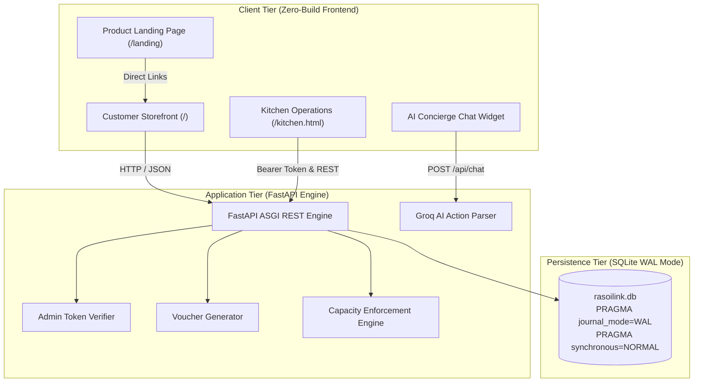

<div align="center">

# RasoiLink
### Zero-Commission Direct Mobile Ordering & Real-Time Kitchen Display System (KDS)

**Developed by Team TrueAddams**

[](https://github.com/akshdeepsingh7/RasoiLink/actions)
[](https://github.com/akshdeepsingh7/RasoiLink)
[](https://github.com/akshdeepsingh7/RasoiLink)
[](https://www.python.org/)
[](https://fastapi.tiangolo.com/)
[](https://www.sqlite.org/wal.html)
[](https://groq.com/)
[](https://developer.mozilla.org/)
[](DOCUMENTATION.md)
[](https://opensource.org/licenses/MIT)

*Eliminating peak-hour counter queues and 18–30% delivery aggregator commissions for local Indian cafes, bistros, and tapris.*

[Product Landing Page](http://127.0.0.1:8000/landing) • [Customer Storefront](http://127.0.0.1:8000/) • [Table 5 QR Demo](http://127.0.0.1:8000/?table=5) • [Kitchen KDS Board](http://127.0.0.1:8000/kitchen.html) • [OpenAPI Docs](http://127.0.0.1:8000/docs) • [GitHub Repository](https://github.com/akshdeepsingh7/RasoiLink)

</div>

---

## Table of Contents

- [Overview](#overview)
- [Competitive Advantage Matrix](#competitive-advantage-matrix)
- [System Architecture](#system-architecture)
- [Four Integrated Interfaces](#four-integrated-interfaces)
  - [1. User-Friendly Product Landing Page (`/landing`)](#1-user-friendly-product-landing-page-landing)
  - [2. Customer Mobile Web Storefront (`/`)](#2-customer-mobile-web-storefront-)
  - [3. Kitchen Display System & Operations Board (`/kitchen.html`)](#3-kitchen-display-system--operations-board-kitchenhtml)
  - [4. Interactive OpenAPI Documentation (`/docs`)](#4-interactive-openapi-documentation-docs)
- [Admin & Staff Authentication](#admin--staff-authentication)
- [Key Features](#key-features)
- [Technical Architecture & Database](#technical-architecture--database)
- [REST API Reference](#rest-api-reference)
- [Quickstart & Local Installation](#quickstart--local-installation)
- [Docker Deployment](#docker-deployment)
- [Cloud Deployment (Render & Railway)](#cloud-deployment-render--railway)
- [Verification & Automated Testing](#verification--automated-testing)
- [Technical Manual & Full Documentation](#technical-manual--full-documentation)
- [Team TrueAddams](#team-trueaddams)
- [License](#license)

---

## Overview

**RasoiLink** is an end-to-end direct restaurant ordering platform and Operations Management Suite engineered specifically for quick-service Indian cafes, bistros, and cloud kitchens. It connects customers' mobile browsers directly to the kitchen cookline with sub-second synchronization, zero app installation, and zero third-party commissions.

Built with a **zero-build** frontend (clean HTML5, Tailwind CSS via CDN, Lucide vector icons, and vanilla ES6+ JavaScript) served by a high-throughput **FastAPI** backend with **SQLite in WAL mode**, role-based **Admin Authentication**, and **Groq LLM** intelligence.

---

## Competitive Advantage Matrix

| Capability | Delivery Aggregators (Swiggy/Zomato) | Traditional POS (Petpooja/Toast) | RasoiLink Direct OS |
| :--- | :--- | :--- | :--- |
| **Platform Commission** | **18% – 30% per ticket** | Monthly subscription + card fees | **0% Commission (Keep 100%)** |
| **Customer Data Ownership** | Monopolized (Customer data masked) | Partial | **100% Direct Customer Loyalty** |
| **Customer App Requirement** | Heavy app download required | None | **Zero-Build PWA (Instant Camera Scan)** |
| **Kitchen Overload Protection** | None (Kitchens get flooded) | Manual throttling | **30-Min Slot Capacity Caps** |
| **AI Ordering Assistant** | Generic search | None | **Groq Llama 3.3 Strict JSON Concierge** |
| **Automated Customer Retention** | Push ads for competitors | Paid SMS marketing add-on | **Automatic 7-Day Bounce Vouchers** |
| **KOT Thermal Printing** | Requires proprietary printer box | Complex driver setup | **1-Tap 80mm/58mm Browser Thermal KOT** |

---

## System Architecture



---

## Four Integrated Interfaces

RasoiLink provides four dedicated user interfaces designed for distinct operational workflows:

### 1. User-Friendly Product Landing Page (`/landing`)
- High-converting, friendly SaaS presentation designed for cafe founders and evaluators.
- Explains the economic burden of aggregator commissions (0% vs 25–30%).
- **Interactive ROI Commission Savings Calculator** with real-time turnover slider.
- **Interactive 3-way live product preview** (Customer Storefront, Kitchen KDS, AI Concierge).
- Permanent attribution to Team TrueAddams.

### 2. Customer Mobile Web Storefront (`/`)
- **QR Table Detection (`/?table=5`)**: Automatically binds table numbers from table tent QR scans, activates Dine-In mode, and tags kitchen tickets.
- **3 Segregated Ordering Channels with Dedicated Scheduling**:
  - **Dine-In**: Dedicated table selection or QR detection with party size selector (1 to 6+ guests). Supports **Immediate Table Service** or **Advance Table Reservation** with date and 30-minute table arrival slot.
  - **Takeaway**: Fast counter pickup workflow with packaging and cooking notes. Supports **Immediate Kitchen Prep** (~15-20 mins) or **Advance Takeaway Pickup** with date and 30-minute collection window.
  - **Delivery**: Direct doorstep delivery with full street address, flat/floor number, and landmark capture (+₹30 standard delivery fee). Includes **1-Tap GPS Device Location Detection** and quick local neighborhood picks (Connaught Place, Barakhamba Road, Janpath, KG Marg). Supports **Immediate Doorstep Delivery** (~35-45 mins) or **Advance Scheduled Delivery** with date and 30-minute drop-off window.
- **Dynamic Store Branding & Local Location Header**: Clean, warm cafe storefront banner displaying dynamic Store Title, Tagline, Description, Local Location badge, Operating Hours, and live Announcement banner managed directly by the Admin.
- **Customer Frequency Loyalty & Margin-Aware Discount Engine**:
  - **Frequency-Based Loyalty Tiers**: Automatically verifies customer order history by mobile number:
    - `WELCOME50`: First-time customer welcome offer (0 prior orders).
    - `REPEAT15`: 15% OFF for returning diners (1+ prior orders).
    - `REGULAR20`: 20% OFF for Cafe Regular Club patrons (3+ prior orders).
    - `VIP25`: 25% OFF VIP TrueAddams Circle privilege (5+ prior orders).
  - **Dish Margin Protection**: Prevents restaurant losses by enforcing a mathematical discount ceiling based on each dish's gross profit margin ($Margin = Sale\ Price - Food\ Cost$). Disallow discounts exceeding the safe margin share, ensuring the kitchen never sells at a loss.
- **Multi-Day Advance Slot Scheduling**: Book 30-minute advance time slots for Today, Tomorrow, or Day +2, with **hard order capacity limits** preventing kitchen bottlenecks.
- **Interactive Dish Quick View Modal**: High-res imagery, spice meter (Mild, Medium, Spicy), calorie estimates (`~320 kcal`), allergen disclosure (`Dairy, Gluten`), and cooking notes.
- **Quick Lifestyle Filters**: Filter dishes by `All Dishes`, `Best Sellers`, `Pure Veg`, `Under 100`, `Spicy Kick`, and `Sweet Treats`.
- **Green Dining**: `Skip plastic cutlery & napkins` toggle to reduce disposable plastic waste.
- **Staff Appreciation**: Tip selector supporting ₹0, ₹10, ₹20, and ₹50 additions.
- **Simulated Instant Digital Checkout**: UPI app selector (GPay, PhonePe, Paytm, Cred) and card simulator with 256-bit confirmation.
- **Real-Time Receipt & Tracking**: 4-step live order status bar (`PENDING` -> `PREPARING` -> `READY` -> `COMPLETED`) with 1-click cancellation while in `PENDING` state, itemized breakdown, 80mm guest check receipt print, and WhatsApp share.

### 3. Kitchen Display System & Operations Board (`/kitchen.html`)
- **Authentication Gate**: Locked with numeric Quick Staff PIN (`1234`) or Manager credentials (`admin` / `rasoi2026`). Features an on-screen tactile keypad for touchscreen POS displays.
- **Tab 1: Live Kitchen Production Board (KDS)**:
  - **Channel-Segregated 3-Queue Architecture**:
    - **Queue 1: Dine-In Queue** (Live table orders and Advance Table Reservations with Party Size badge & Table #).
    - **Queue 2: Takeaway Queue** (Live counter pickups and scheduled takeaway pickups with customer notes).
    - **Queue 3: Delivery Queue** (Live deliveries and scheduled drop-offs with full street address and landmark).
  - **KDS Timing Filter Pills**: 1-click toggle between `All Timings`, `Immediate Now`, and `Scheduled Advance`.
  - Color-shifting elapsed timers that turn amber at 10 minutes and flashing red at 18 minutes.
  - Approaching prep time alerts for advance orders (`DUE IN 15m`, `OVERDUE by 5m`).
  - 1-tap status updates: `PENDING` -> `PREPARING` -> `READY` -> `COMPLETED`.
  - 1-click **80mm KOT Thermal Printing** with formatted monospace ticket layout.
- **Tab 2: Menu & Stock Manager**:
  - Live catalog table showing prices, food cost, profit margin percentage, dietary badges, calories, and allergens.
  - Inline price editing (updates menu prices in real time).
  - 1-tap stock availability switches immediately reflected on the storefront.
  - "Edit Dish Details" modal allowing admin to customize Dish Title, Description, Category, Sale Price, Cost Price, Spice Level, Calories, and Allergens.
  - "Add New Dish" modal to add new culinary creations on the fly.
- **Tab 3: Promo & Retention Engine**:
  - Review active loyalty codes (`WELCOME50`, `REPEAT15`, `REGULAR20`, `VIP25`, `HAPPY20`, `RASOI10`) and dynamic 7-day bounce-back coupons.
  - Create custom campaign codes with customer frequency tier requirements (`ALL`, `FIRST_TIME`, `REPEAT`, `REGULAR`, `VIP`) and food margin protection caps (10% to 80%).
- **Tab 4: Advance Capacity Planner**:
  - Date picker to view and update order capacity caps per 30-minute booking slot.
- **Tab 5: Business Analytics**:
  - Real-time Gross Revenue, Total Orders, Average Order Value (AOV), and Retention Coupon Redemption Rate.
  - Channel distribution charts (Dine-In vs Takeaway vs Delivery).
  - Top 5 bestselling dishes table.
- **Tab 6: Store Profile & Settings**:
  - Live customization of Store Name / Title, Tagline, Description, Local Location Name, Full Physical Address, Operating Hours, Phone / WhatsApp, and Store Announcement.
- **Table QR Tent Card Generator**: Pure SVG in-browser generator with printable tent card view.
- **Multi-Tone Web Audio Chimes**: Synthesized audio alerts for new orders, ready tickets, and completion.

### 4. Interactive OpenAPI Documentation (`/docs`)
- Full interactive Swagger documentation testing all REST endpoints with live requests and responses.
- Alternate ReDoc format available at `/redoc`.

---

## Admin & Staff Authentication

The Operations Dashboard (`/kitchen.html` or `/admin`) is gated with role-based authentication:

| Login Method | Demo Credentials | Typical Role | Privileges |
| :--- | :--- | :--- | :--- |
| **Quick Staff PIN** | **PIN:** `1234` | Kitchen Cooks, Baristas, Line Staff | Ticket progression, Stock toggles, 80mm KOT printing |
| **Manager Login** | **Username:** `admin`<br/>**Password:** `rasoi2026` | Head Chef, Restaurant Owner, General Manager | Full access: Analytics, Price editing, Promo creation, Slot caps |

- Features an on-screen tactile numeric keypad for touchscreen POS terminals and tablets.
- Issues secure 24-hour cryptographic session tokens (`RS-SESSION-XXXX`) verified on every administrative API request.
- One-click demo fill buttons for frictionless evaluator testing.

---

## Key Features

### 1. Automated Customer Retention Engine
Every completed order automatically generates a unique, single-use 7-day bounce-back voucher (e.g. `BACK50-XXXX` for ₹50 off min ₹150 spend). This brings customers back within a week without paying for expensive remarketing ads.

### 2. 30-Minute Advance Slot Capacity Guard
Restaurateurs set maximum orders allowed per 30-minute booking window (default: 8). When a slot fills up, the customer storefront automatically marks it as "Full" and prompts the user to select the next available slot, protecting the kitchen from rush-hour chaos.

### 3. Floating AI Concierge (Powered by Groq Llama 3.3)
- Ingests live menu items, prices, spice levels, stock availability, and current cart context.
- Emits structured JSON actions (`ADD_ITEM`, `REMOVE_ITEM`, `APPLY_COUPON`, `SET_SCHEDULE`) that directly mutate the cart tray state.
- Integrated voice assistant via browser `window.speechSynthesis`.
- Rule-based fallback engine guarantees 100% operational uptime if offline or without API key.

### 4. 1-Click Re-Ordering & Customer Meal History
- Customer orders and receipts are saved locally (`rasoilink_order_history`).
- The "My Orders" customer portal lets diners review past visits and re-fill their tray with a single click.

### 5. Multi-Profile Kitchen Alert Synthesizer
- Zero audio file downloads: synthesizes real-time tones using HTML5 `AudioContext`.
- Includes Volume Slider (10%-100%) and 4 audio tone profiles: Modern Chime, Counter Bell, Kitchen Buzzer, and Soft Marimba.

### 6. Accounting CSV Export & Financial Reporting
- Download itemized orders (`/api/admin/export/orders.csv`) for accountant spreadsheets.
- Download daily closing summaries (`/api/admin/export/daily-closing.csv`) aggregating gross sales, net revenue, discounts, and tips.

### 7. Dual Thermal Printing & Direct WhatsApp Sharing
- Kitchen Order Tickets (80mm KOT) for cookline tickets.
- Customer Guest Check Thermal Printing with dedicated `@media print` CSS.
- One-click bill and tracking link share directly to WhatsApp.

---

## Four Breakthrough Engines Built for Bharat

RasoiLink 2.0 introduces four revolutionary systems engineered to transform local cafe and restaurant economics:

```
┌──────────────────────────────────────────────────────────────────────────┐
│                      RASOILINK 2.0 BHARAT OS ENGINES                    │
├──────────────────────────┬──────────────────────────┬────────────────────┤
│ 🌱 AI Waste-to-Profit    │ 📢 AI Marketing          │ 👥 Group Hunger    │
│    Engine                │    Autopilot             │    Network         │
│ • Shift Demand Forecast  │ • RFM Segmentation       │ • Hostel & Office  │
│ • Surplus Spoilage Guard │ • WhatsApp Deep Links    │   Order Pools      │
│ • 25%–50% Flash Deals    │ • Win-Back Campaigns     │ • 10%–25% Tiers    │
│ • Meals Rescued Ticker   │ • Automated Retention    │ • Live Room Drawer │
├──────────────────────────┴──────────────────────────┴────────────────────┤
│ 📶 Offline-First Bharat Mode & Regional Voice Accessibility              │
│ • 100% Zero-Internet PWA Service Worker (Pre-cached Menus & Assets)      │
│ • Local Device Order Queue with Idempotent Auto-Sync on Reconnection     │
│ • 8 Indian Languages: Hindi, Hinglish, Gujarati, Marathi, Tamil, Bengali, │
│   Telugu, English with Real-Time DOM Translation                         │
│ • Multilingual Voice Search & Voice-to-Cart Ordering (Web Speech API)   │
└──────────────────────────────────────────────────────────────────────────┘
```

### 1. 🌱 AI Waste-to-Profit Engine
- **Predictive Demand Model**: Calculates expected sales per dish considering day-of-week multipliers (weekends 1.3x), shift progress, and perishable shelf lives.
- **Surplus Spoilage Mitigation**: Detects high-risk leftover batches (e.g., afternoon prep rolls, fresh gravies, desserts) nearing shift close.
- **Dynamic Flash Deals**: 1-click trigger from kitchen to apply 25%–50% discounts on the customer storefront.
- **Sustainability Metrics**: Live counters for meals rescued, rupees saved from disposal, and CO₂ emissions avoided.

### 2. 📢 AI Marketing Autopilot
- **RFM Segmentation Engine**: Automatically categorizes customer history into actionable segments (`CHURN_RISK`, `VIP_LOYALISTS`, `BIRYANI_LOVERS`, `CHAI_SQUAD`, `WEEKEND_REGULARS`, `FIRST_TIMER_WINBACK`).
- **Personalized WhatsApp Offers**: Crafts tailored messages with diner name, favorite dish, and unique dynamic promo codes.
- **1-Click Click-to-Chat**: Generates WhatsApp links (`wa.me`) enabling direct dispatches without third-party aggregator ad costs.
- **Campaign ROI Tracker**: Measures total recipients, sent counts, open clicks, and incremental revenue generated.

### 3. 👥 Group Hunger Network
- **Social Food Pooling**: College students, hostel wings, and corporate office teams combine food orders into a shared pool.
- **Tiered Group Discounts**:
  - **Tier 1 (10% OFF)**: ₹400+ or 2+ diners
  - **Tier 2 (15% OFF)**: ₹800+ or 4+ diners + Free Extra Chai
  - **Tier 3 (25% Mega Saver)**: ₹1,500+ or 6+ diners
- **Live Pool Room Drawer**: Real-time participant tracker, countdown timer, shareable link (`/?pool=HOSTEL`), and 1-click batch cookline order generation.

### 4. 📶 Offline-First Bharat Mode & Regional Voice
- **Zero-Internet Ordering**: PWA Service Worker caches app shell, menus, and assets. When connectivity drops, orders queue locally with `OFFLINE-XXXX` reference codes.
- **Background Auto-Sync**: Automatically detects network reconnection and safely synchronizes local orders to the kitchen via SQLite WAL transactions.
- **8 Indian Languages**: English, हिन्दी (Hindi), हिंग्लिश (Hinglish Tapri), ગુજરાતી (Gujarati), मराठी (Marathi), தமிழ் (Tamil), বাংলা (Bengali), and తెలుగు (Telugu).
- **Voice Ordering**: Hands-free voice ordering and menu search powered by the Web Speech API and natural speech feedback.

---

## Technical Architecture & Database

RasoiLink uses SQLite 3 with Write-Ahead Logging (`WAL` mode) and synchronous normalized writes:

```sql
PRAGMA journal_mode = WAL;
PRAGMA synchronous = NORMAL;
PRAGMA foreign_keys = ON;
```

### Relational Schema Summary (15 Tables)
1. `categories`: 5 seeded categories with vector icon identifiers.
2. `menu_items`: 22 seeded Indian cafe dishes with calories, allergens, and dietary tags.
3. `orders`: Full order details, payment statuses, staff tips, group pool codes, and offline sync flags.
4. `promo_codes`: Marketing vouchers, margin caps, and dynamic 7-day bounce-back coupons.
5. `time_slots`: 25 daily 30-minute advance slots with capacity controls.
6. `admin_users`: Staff PINs and Manager credentials with salted SHA-256 hashes.
7. `admin_sessions`: Active 24-hour cryptographic session bearer tokens.
8. `restaurants`: Multi-outlet franchise branches and operational metadata.
9. `store_settings`: Dynamic store branding, addresses, and announcements.
10. `waste_flash_deals`: AI dynamic flash discounts with quantity caps and expirations.
11. `waste_logs`: Audit trail of rescued food meals, revenue recovered, and CO₂ prevented.
12. `marketing_campaigns`: WhatsApp autopilot campaigns and conversion ROI metrics.
13. `group_pools`: Group Hunger Network pooling rooms, tiers, and countdown timers.
14. `group_pool_members`: Individual participant orders within a shared pool.
15. `safekitchen_audits`: Audited kitchen hygiene protocols, FSSAI verification, and outlet Trust Scores.

*For complete schema specifications and data dictionary, see [DOCUMENTATION.md](DOCUMENTATION.md#4-database-architecture--wal-concurrency).*

---

## REST API Reference

| Method | Endpoint | Auth | Description |
| :--- | :--- | :--- | :--- |
| `GET` | `/api/health` | None | Health check & Groq configuration status |
| `POST` | `/api/admin/login` | None | Authenticate with Staff PIN (`1234`) or Manager credentials (`admin`/`rasoi2026`) |
| `GET` | `/api/admin/verify` | Bearer | Verify active session token |
| `POST` | `/api/admin/logout` | Bearer | Terminate admin session token |
| `GET` | `/api/admin/analytics` | Bearer | High-level sales intelligence, channel distribution, and retention rate |
| `GET` | `/api/admin/promos` | Bearer | List all campaign promo codes and bounce-back retention vouchers |
| `POST` | `/api/admin/promos` | Bearer | Create a new custom promotional code |
| `POST` | `/api/admin/menu/item` | Bearer | Add a new culinary dish to the live catalog |
| `PATCH`| `/api/admin/menu/{id}` | Bearer | Update dish price, bestseller status, or availability |
| `GET` | `/api/menu` | None | All menu categories and dishes with availability, calories & allergens |
| `POST` | `/api/menu/{id}/toggle-stock` | None | Toggle dish stock availability on/off |
| `GET` | `/api/slots?date=YYYY-MM-DD` | None | 30-min slots with capacity and booked counts |
| `POST` | `/api/slots/capacity` | Bearer | Update maximum capacity for a time slot |
| `POST` | `/api/coupons/validate` | None | Validate promo code against order subtotal |
| `POST` | `/api/orders` | None | Place order (enforces slot caps, issues bounce coupon) |
| `GET` | `/api/orders` | None | List active orders (filterable by status) |
| `GET` | `/api/orders/{code}` | None | Retrieve single order status for live tracking |
| `POST` | `/api/orders/{code}/status` | None | Advance ticket status (PENDING -> PREPARING -> READY -> COMPLETED) |
| `POST` | `/api/orders/{code}/cancel` | None | Cancel an order and release slot capacity |
| `GET` | `/api/kitchen/stats` | None | Real-time kitchen operations analytics and revenue |
| `POST` | `/api/chat` | None | AI chatbot ordering assistant with strict action parser |
| `GET` | `/api/admin/export/orders.csv` | Bearer | Export accounting CSV with itemized orders and customer totals |
| `GET` | `/api/admin/export/daily-closing.csv` | Bearer | Export daily aggregated sales, discounts, tips, and channel reports |
| `GET` | `/api/waste-to-profit/predictions` | None | Predict daily food demand and surplus inventory risk |
| `POST` | `/api/waste-to-profit/apply-discount` | None | Activate an Eco-Saver flash deal on surplus items |
| `GET` | `/api/waste-to-profit/active-deals` | None | Fetch active flash discounts for storefront carousel |
| `GET` | `/api/waste-to-profit/impact` | None | Real-time sustainability metrics (meals saved, ₹ recovered, CO₂) |
| `GET` | `/api/marketing/segments` | None | RFM customer segmentation (Churn risk, VIP, Chai regulars) |
| `POST` | `/api/marketing/campaigns` | None | Generate and deploy an AI WhatsApp marketing campaign |
| `GET` | `/api/marketing/campaigns` | None | Retrieve past marketing campaign performance and conversions |
| `POST` | `/api/marketing/preview-offer` | None | Generate personalized WhatsApp click-to-chat copy |
| `POST` | `/api/group-pools` | None | Create a new hostel, office, or society order pool |
| `GET` | `/api/group-pools` | None | Discover open community pools near user's locality |
| `GET` | `/api/group-pools/{code}` | None | Live pool room details, participants, tier progress, countdown |
| `POST` | `/api/group-pools/{code}/join` | None | Add customer items to pool and unlock tiered discounts |
| `POST` | `/api/group-pools/{code}/finalize` | None | Consolidate pooled orders into a master kitchen ticket |
| `POST` | `/api/orders/sync-offline` | None | Synchronize single locally queued offline order (Idempotent) |
| `POST` | `/api/orders/sync-batch` | None | Synchronize batch of offline orders placed without internet |
| `GET` | `/api/orders/offline-status` | None | Node connectivity and offline orders synchronization statistics |
| `GET` | `/api/safekitchen/{restaurant_id}` | None | Retrieve audited kitchen hygiene protocols & Trust Score |
| `GET` | `/api/safekitchen` | None | Default outlet SafeKitchen audit status and checklist |

---

## Quickstart & Local Installation

### Prerequisites
- Python 3.11, 3.12, or 3.13
- (Optional) Free Groq API Key from [console.groq.com](https://console.groq.com/)

### 1. Clone & Setup
```bash
# Clone the repository
git clone https://github.com/akshdeepsingh7/RasoiLink.git
cd RasoiLink

# Create virtual environment
python -m venv .venv
source .venv/bin/activate  # On Windows: .venv\Scripts\activate

# Install dependencies
pip install -r requirements.txt
```

### 2. Configure Environment
```bash
cp .env.example .env
```
*(Optional)* Add your `GROQ_API_KEY` in `.env`. If left empty, the application uses its built-in rule-based fallback with zero configuration needed.

### 3. Run the Server

#### A. Local Development (Uvicorn Live-Reload)
```bash
python -m uvicorn main:app --host 0.0.0.0 --port 8000 --reload
```

#### B. Production Multi-Worker Mode (Gunicorn + Uvicorn ASGI Workers)
```bash
# Production server using optimized gunicorn_conf.py
gunicorn -c gunicorn_conf.py main:app

# Or explicit CLI flags (4 concurrent workers)
gunicorn main:app -w 4 -k uvicorn.workers.UvicornWorker --bind 0.0.0.0:8000
```

Open your browser:
- Product Landing Page: **[http://localhost:8000/landing](http://localhost:8000/landing)**
- Customer Storefront: **[http://localhost:8000/](http://localhost:8000/)**
- QR Table 5 Simulation: **[http://localhost:8000/?table=5](http://localhost:8000/?table=5)**
- Operations & KDS Board: **[http://localhost:8000/kitchen.html](http://localhost:8000/kitchen.html)**
- OpenAPI Interactive Docs: **[http://localhost:8000/docs](http://localhost:8000/docs)**

---

## Docker Deployment

Run RasoiLink in a single command with Docker (pre-configured with multi-worker Gunicorn):

```bash
docker-compose up --build -d
```
The application will be live at `http://localhost:8000/`.

---

## Cloud Deployment (Render & Railway)

### Deploy to Render
1. Create a new **Web Service** on [Render](https://render.com/).
2. Connect your GitHub repository.
3. Render automatically detects `render.yaml` or use:
   - **Build Command:** `pip install -r requirements.txt`
   - **Start Command:** `gunicorn -c gunicorn_conf.py main:app`
4. Add `GROQ_API_KEY` under Environment Variables.

### Deploy to Railway
1. Create a new project on [Railway](https://railway.app/).
2. Deploy from GitHub repo. Railway automatically detects `Procfile` (`gunicorn -c gunicorn_conf.py main:app`) and `requirements.txt`.

---

## Verification & Automated Testing

RasoiLink includes an end-to-end automated verification test suite:

```bash
python verify_system.py
```

### Test Coverage Summary (27/27 Passing)
- [x] SQLite database schema initialization and WAL journal mode
- [x] Menu categories and 22 Indian cafe dishes seeded with nutritional metadata
- [x] Admin Quick PIN Authentication (`1234`)
- [x] Admin Manager Credentials Authentication (`admin` / `rasoi2026`)
- [x] Admin Session Token Verification
- [x] Admin Business Analytics and Sales Reporting
- [x] Custom Promo Code Creation on the fly
- [x] 1-tap item out-of-stock toggling
- [x] 30-minute advance slot capacity controls and limits
- [x] Promo code validation engine (`HAPPY20`, `WELCOME50`, `RASOI10`)
- [x] Dine-in order creation with table parameter, staff tip, and green cutlery flag
- [x] Automated retention engine: unique single-use bounce-back voucher generation (`BACK50-XXXX`)
- [x] Verification that bounce-back vouchers are redeemable on subsequent orders
- [x] Order status transitions (`PENDING` -> `PREPARING` -> `READY` -> `COMPLETED`)
- [x] Kitchen operations analytics (`/api/kitchen/stats`)
- [x] Order cancellation flow (`/api/orders/{code}/cancel`)
- [x] AI Chatbot structured action parser (`ADD_ITEM`, `APPLY_COUPON`, `SET_SCHEDULE`)
- [x] Admin Session Logout
- [x] Financial & Accounting CSV Export Pipelines
- [x] All 6 Channel Order permutations verified in active queue
- [x] Margin-Aware Discount Engine and Customer Frequency Protection
- [x] Multi-Restaurant Network & Kitchen Outlet Isolation
- [x] AI Waste-to-Profit Engine: 22-dish demand forecasting, surplus risk detection & flash deal activation
- [x] AI Marketing Autopilot: RFM segmentation, WhatsApp click-to-chat copy generator & campaign dispatch
- [x] Group Hunger Network: Social pooling, 10%–25% tier discount unlocks & kitchen batch consolidation
- [x] Offline-First Bharat Mode: Zero-internet local queueing, idempotency & background auto-sync
- [x] SafeKitchen Verified Engine: 9/9 hygiene protocols in order, Trust Score 98/100, FSSAI verification & multi-outlet audits

---

## Technical Manual & Full Documentation

For the complete technical manual covering the internal database schemas, state machines, retention algorithms, audio synthesis curves, and POS operations manual, see:

**[DOCUMENTATION.md](DOCUMENTATION.md)**

---

## Team TrueAddams

| Member | Role | Responsibilities |
| :--- | :--- | :--- |
| [**Akshdeep Singh**](https://github.com/akshdeepsingh7) | **Team Leader** | System Architecture, FastAPI Backend Engine, SQLite WAL Pipeline, Role-Based Admin Auth, KDS Dispatch Integration, and Test Automation |
| **Paras Gupta** | **Core Contributor** | Mobile-First Customer Storefront UI/UX, Component Architecture, Order State Engine, and Tailwind CSS Design System |
| **Prince Pratik** | **Core Contributor** | Groq AI Concierge Engine (Llama 3.3 70B), Dynamic Prompt Engineering, Live Menu Context Injection, and Strict JSON Action Parser |
| **Akashdeep Singh** | **Core Contributor** | Live KDS Production Board, 80mm KOT Thermal Receipt Printing, SVG Table QR Tent Card Generator, and End-to-End Test Suite |

---

## Repository

- **GitHub Repository**: [https://github.com/akshdeepsingh7/RasoiLink](https://github.com/akshdeepsingh7/RasoiLink)
- **Issues & Contributions**: [https://github.com/akshdeepsingh7/RasoiLink/issues](https://github.com/akshdeepsingh7/RasoiLink/issues)

---

## License

This project is licensed under the MIT License - see the [LICENSE](LICENSE) file for details.
